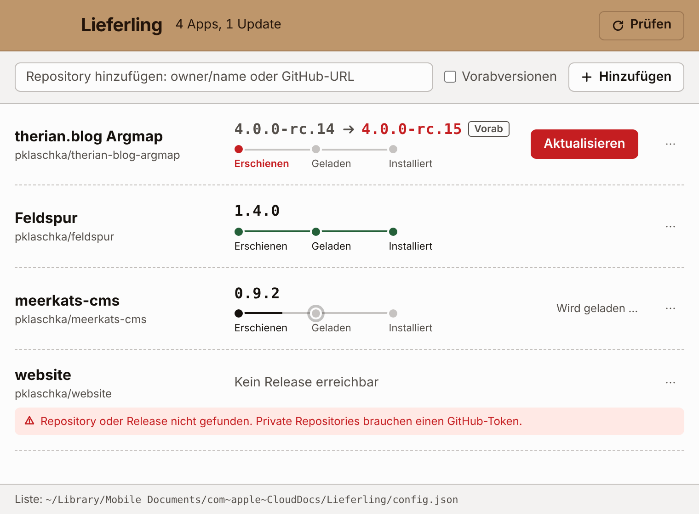
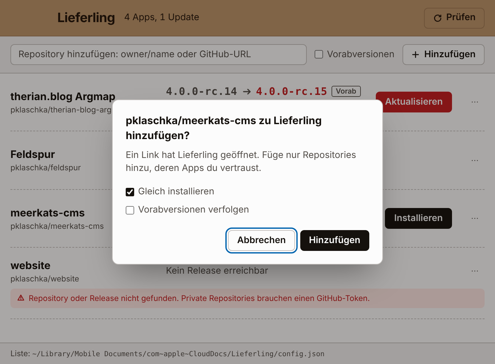

<p align="center">
  
</p>

<h1 align="center">Lieferling</h1>

<p align="center">
  Installs and updates your own desktop apps from GitHub releases.<br>
  A small app store for the (often private, often unsigned) Electron apps you build yourself.
</p>

<p align="center">
  <a href="https://github.com/pklaschka/lieferling/releases/latest"><b>Download for macOS</b></a>
  &nbsp;·&nbsp;
  <a href="#command-line">Command line</a>
  &nbsp;·&nbsp;
  <a href="#links-for-a-readme">Links for a README</a>
</p>

<picture>
  <source media="(prefers-color-scheme: dark)" srcset="docs/window-dark.png">
  
</picture>

Add a repository once, then install, update and remove its app with one click or one command. Every app on the list reads like a parcel label: the installed version, the newest one, and a tracking strip from *Erschienen* to *Geladen* to *Installiert*.

- **App with menu bar icon:** one click installs or updates. Lieferling checks for updates in the background every 6 hours and notifies you when there are new ones.
- **Command line:** `lieferling` does the same from the terminal.
- **Synced across your Macs:** the list lives in iCloud Drive (`Lieferling/config.json`), so every Mac on the same iCloud account sees it. What is installed stays per Mac.
- **Keeps itself current:** put `pklaschka/lieferling` on its own list.

macOS only for now. Windows and Linux are prepared (see `internal/install`) but not built.

## Formerly Elappma

Lieferling was called Elappma until v0.2.1. When it first starts, Lieferling copies the list from iCloud Drive (`Elappma/config.json` → `Lieferling/config.json`) and the local state, and moves its own entry to `pklaschka/lieferling`. An `Elappma.app` that updated itself to Lieferling gets quit and moved to the Bin. The Keychain item "Elappma GitHub", the `ELAPPMA_*` variables and `elappma://` links keep working. The command line is now `lieferling`.

## Install

Download the DMG from the [releases](https://github.com/pklaschka/lieferling/releases) and drag Lieferling into Applications. The app is not signed by Apple, so clear the quarantine flag once:

```sh
xattr -cr /Applications/Lieferling.app
```

Add `pklaschka/lieferling` to its own list and Lieferling keeps itself up to date: an update replaces the app while it runs and then restarts it. Any other app that was open during its update is opened again afterwards.

## Links for a README

A link can put an app on the list and install it. GitHub only links to `https`, so a README links to the landing page, which hands the request to Lieferling:

```markdown
[In Lieferling installieren](https://pklaschka.github.io/lieferling/?repo=owner/name&install=1)
```

| Parameter | |
|---|---|
| `repo` | `owner/name` or the repository's URL |
| `install=1` | install right after adding |
| `prerelease=1` | follow release candidates |

Lieferling always asks before adding or installing:

<p align="center"></p>

"Link für die README kopieren" in an app's menu copies such a link for that app. Under the hood the page opens `lieferling://add?repo=owner/name&install=1`, which works anywhere else links to custom schemes are allowed.

The landing page lives in `site/` and is published by the Pages workflow. GitHub Pages has to be switched on once: Settings → Pages → Source: GitHub Actions.

## Private repositories

Public repositories work without signing in. For private ones Lieferling needs a GitHub token with read access to the repository's contents. It looks, in this order, at:

1. `GH_TOKEN` or `GITHUB_TOKEN`,
2. the GitHub CLI's login (`gh auth login`),
3. the Keychain item "Lieferling GitHub":

   ```sh
   security add-generic-password -s "Lieferling GitHub" -a github -w
   ```

The token is never synced; set it up on each Mac.

## Command line

```text
lieferling list                         apps on the list, installed and newest version
lieferling add <repo> [--prerelease]    put a repository on the list
lieferling install <repo>               install (adds it to the list if needed)
lieferling update [<repo>...]           update the given apps, or every app with an update
lieferling channel <repo> stable|prerelease
lieferling remove <repo> [--uninstall]  take it off the list (and off this computer)
lieferling paths                        where the shared and the local files are
```

`<repo>` is `owner/name` or the repository's GitHub URL.

## How it picks what to install

- **Release:** the newest non-draft release; on the `stable` channel release candidates (GitHub "pre-releases") are skipped.
- **File:** the release asset that fits this Mac. A `.dmg` beats a `.zip`; a file naming this processor (`arm64`, `x64`, …) beats a `universal` one, which beats one naming no processor. On Apple Silicon an Intel-only build is the last resort (it runs through Rosetta). Files naming another system are never picked, and a bare `.zip` only when it names macOS.
- **Install:** like the original script. Quit the running app (it may ask about unsaved work), replace the copy in `/Applications` and clear the quarantine flag. When `/Applications` is not writable, Lieferling asks for an administrator password.

If two Macs change the list at the same time, iCloud keeps both files ("config 2.json"); Lieferling merges them the next time it writes. An app removed on one Mac can come back that way, so remove it again.

## Development

Requires Go 1.26, Node 22 and the Wails CLI (`go install github.com/wailsapp/wails/v3/cmd/wails3@v3.1.0`).

```sh
wails3 dev                         # the app with hot reload
go test ./internal/... ./cmd/...   # the core
go run ./cmd/lieferling list          # the command line
wails3 task darwin:package         # Lieferling.app in bin/ (on a Mac)
```

`LIEFERLING_CONFIG`, `LIEFERLING_STATE` and `LIEFERLING_APPLICATIONS` move the shared list, the local state and the install folder, which helps when trying things out.

Releases are automatic: every merge into `main` is released. The release workflow picks the version from the commits since the last release (`scripts/next-version.sh`), builds the universal DMG and the command line, and publishes them as a GitHub release.

| In a commit message | Version |
|---|---|
| `feat!:`, `BREAKING CHANGE:` or `[major]` | major (before 1.0.0: minor) |
| `feat:`, `feat(scope):` or `[minor]` | minor |
| anything else | patch |

With squash merges the PR title is the commit message, so put the marker there.

## Layout

| Path | What |
|---|---|
| `internal/github` | GitHub releases and downloads, token lookup |
| `internal/pick` | channel, version and asset choice |
| `internal/config` | the synced list (iCloud Drive) |
| `internal/state` | what is installed on this computer |
| `internal/install` | putting an app in place (macOS so far) |
| `internal/store` | the core both front ends use |
| `internal/deeplink` | `lieferling://` links |
| `site/` | the landing page for README links (GitHub Pages) |
| `docs/` | images for this README |
| `build/appicon.icon`, `build/appicon.png` | the app icon (Icon Composer layers and the classic icon) |
| `cmd/lieferling` | the command line |
| `main.go`, `service.go`, `frontend/` | the Wails app |

## License

Copyright (c) 2026 Zuri Nimca Klaschka. Licensed under the [European Union Public Licence v. 1.2](LICENSE) (EUPL-1.2).
